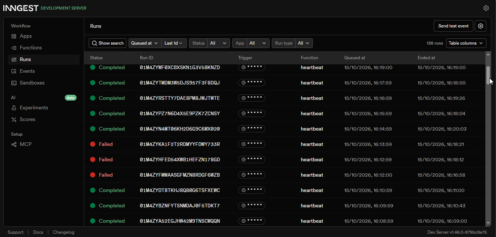

# Background Workflows — FlyRank Internship · Week 4 · A7

A small Express API that demonstrates the background job pattern: accept fast, work in the background, report status.

---

## How to run

**Terminal 1 — API server:**

```bash
pnpm dev
```

**Terminal 2 — Inngest Dev Server:**

```bash
pnpm dlx inngest-cli@latest dev -u http://localhost:3000/api/inngest
```

Inngest dashboard: http://localhost:8288

---

## Endpoints

| Method | Path | Description |
|--------|------|-------------|
| GET | `/health` | Health check |
| POST | `/reports` | Create a report — returns 202 instantly |
| GET | `/reports/:id` | Poll report status (`pending` → `done`) |
| GET | `/reports` | List all reports |

## Inngest Functions

| Function | Trigger | Description |
|----------|---------|-------------|
| `make-report` | `report/requested` event | Sleeps 8s, builds the report, updates status |
| `heartbeat` | `* * * * *` cron | Logs pending/done/failed counts every minute |

---

## Proof — 202 then poll

```bash
$ time curl -i -X POST http://localhost:3000/reports -H "Content-Type: application/json" -d '{"topic":"cats"}'
HTTP/1.1 202 Accepted
X-Powered-By: Express
Content-Type: application/json; charset=utf-8
Content-Length: 64
ETag: W/"40-lx1LtsXnmWE3/45jhW9H40wD1d0"
Date: Thu, 15 Oct 2026 11:39:18 GMT
Connection: keep-alive
Keep-Alive: timeout=5

{"id":"86d3988b-f541-4687-86f3-7250a53bda1d","status":"pending"}
real    0m0.213s
user    0m0.031s
sys     0m0.030s
```

---

## Stage 3 — Retries vs bad input

A missing `topic` returns `400` immediately with no job created — retrying
an invalid input will never produce a different result, so no retry is warranted.
A broken service, however, could recover by the next attempt — so that deserves a retry.

---

## Stage 4 — Cron expressions

Every day at 08:00 UTC: `0 8 * * *`

Every Sunday at 22:00 UTC: `0 22 * * 0`

---

## Dashboard screenshot



## Author

AN Mogashoa **CS50AI Student** @2026
